#  Práctica: Instalación de WordPress en Ubuntu 24.04 

-  **Alumno:** Marcos
-  **Ciclo / Módulo:** Sistemas Microinformáticos y Redes (SMR) · Aplicaciones Web
-  **Curso:** 2026/2027 
-  **Fecha:** Octubre de 2026
-  **Máquina:** `smr-web` · Ubuntu 24.04 · IP `192.168.56.16`


---

##  Índice

0. [Antes de empezar: cómo usamos una herramienta gráfica en un servidor sin pantalla](#-antes-de-empezar-cómo-usamos-una-herramienta-gráfica-en-un-servidor-sin-pantalla)
1. [Apartado 1. Conexión por SSH y comprobación del servidor](#apartado-1-conexión-por-ssh-y-comprobación-del-servidor)
2. [Apartado 2. Dejar Apache con un único sitio](#apartado-2-dejar-apache-con-un-único-sitio)
3. [Apartado 3. Crear la base de datos de WordPress](#apartado-3-crear-la-base-de-datos-de-wordpress)
4. [Apartado 4. Descargar e instalar los ficheros de WordPress](#apartado-4-descargar-e-instalar-los-ficheros-de-wordpress)
5. [Apartado 5. Terminar la instalación desde el navegador](#apartado-5-terminar-la-instalación-desde-el-navegador-la-parte-gráfica)
6. [Apartado 6. Comprobamos que WordPress funciona](#apartado-6-comprobamos-que-wordpress-funciona)
7. [Apartado 7. Para que no se rompa si cambia la IP](#apartado-7-para-que-no-se-rompa-si-cambia-la-ip)
8. [Apartado 8. Dos ajustes para trabajar cómodamente](#apartado-8-dos-ajustes-para-trabajar-cómodamente)
9. [Apartado 9. ¿Qué pasa si MariaDB se para?](#apartado-9-qué-pasa-si-mariadb-se-para)
10. [Apartado 10. Comprobación final](#apartado-10-comprobación-final)

---


### ¿Qué es WordPress?

Es un **gestor de contenidos (CMS)**: una aplicación web que permite crear y mantener webs **sin programar** (entradas, páginas, imágenes, temas de diseño y plugins). Está hecha en **PHP** y guarda todo su contenido en la base de datos de **MariaDB**.

---

## Apartado 1. Conexión por SSH y comprobación del servidor

### 1.1. Averiguar la IP del servidor

```bash
hostname -I
```

**Salida:**

```text
10.0.2.15 192.168.56.16 fd17:625c:f037:2:a00:27ff:fe48:ebf8
```

**Explicación:** `hostname -I` muestra **todas las direcciones IP** del servidor. La que uso para conectarme desde mi ordenador es **`192.168.56.16`**. (La `10.0.2.15` es la de otra interfaz de red de la máquina y la última es una dirección IPv6.)


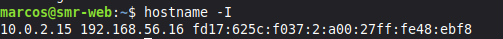

### 1.2. Conectarme por SSH desde mi ordenador

En la terminal de **mi ordenador** (en Windows, PowerShell) escribo:

```bash
ssh marcos@192.168.56.16
```

- La **primera vez** pregunta si confío en el servidor → escribo `yes`.
- Después pide la **contraseña** de mi usuario (al escribirla no se ve nada, es normal).
- A partir de aquí, **todos los comandos de la práctica se escriben en esta terminal**.

> [!NOTE]
> `ssh usuario@IP` = "conéctame al servidor con IP *X* como el usuario *Y*". Por el puerto 22 viaja el texto de la terminal de forma cifrada.


> 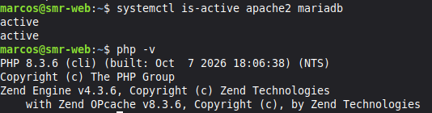

### 1.3. Comprobar que todo lo anterior sigue funcionando

```bash
systemctl is-active apache2 mariadb
php -v
```

**Salida:**

```text
active
active
PHP 8.3.6 (cli) (built: Oct  7 2026 18:06:38) (NTS)
Copyright (c) The PHP Group
Zend Engine v4.3.6, Copyright (c) Zend Technologies
    with Zend OPcache v8.3.6, Copyright (c), by Zend Technologies
```

-  `active` dos veces → **Apache y MariaDB funcionan**.
-  **PHP 8.3.6** instalado.


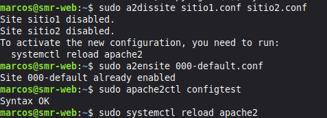

###  Pregunta de reflexión

**¿Qué dos "puertas" (programas y puertos) usas para trabajar con el servidor en esta práctica y para qué sirve cada una?**

1. **SSH (puerto 22), con la terminal:** para **administrar** el servidor: instalar programas, copiar ficheros, crear la base de datos, dar permisos.
2. **HTTP (puerto 80), con el navegador:** para **usar** WordPress: ver la web pública, terminar la instalación gráfica y entrar en el panel de administración.

---

## Apartado 2. Dejar Apache con un único sitio

En la práctica de Apache creé dos sitios (`sitio1` y `sitio2`) y desactivé el sitio por defecto. Ahora el servidor tendrá **un solo sitio**, que será WordPress, y entraré con la **IP del servidor**.

- Los dos sitios antiguos se **desactivan** (sus ficheros **no se borran**).
- Se vuelve a activar el sitio por defecto, cuya carpeta es `/var/www/html`.

### 2.1. Cambiar los sitios activos

```bash
sudo a2dissite sitio1.conf sitio2.conf
sudo a2ensite 000-default.conf
sudo apache2ctl configtest
sudo systemctl reload apache2
```

**Salida:**

```text
Site sitio1 disabled.
Site sitio2 disabled.
To activate the new configuration, you need to run:
  systemctl reload apache2
Site 000-default already enabled
Syntax OK
```

**Qué hace cada comando:**

- `a2dissite sitio1.conf sitio2.conf` → **desactiva** los dos sitios antiguos (borra sus enlaces en `sites-enabled`).
- `a2ensite 000-default.conf` → **activa** el sitio por defecto. Aquí responde *"already enabled"* porque ya estaba activo de la práctica anterior.
- `apache2ctl configtest` → **comprueba la sintaxis** de la configuración **antes** de aplicarla. Debe responder **`Syntax OK`**.
- `systemctl reload apache2` → aplica los cambios **sin cortar** las conexiones.

> [!TIP]
> Si al hacer `configtest` aparece el aviso *"Could not reliably determine the server's fully qualified domain name"*, se soluciona definiendo un nombre de servidor global:
>
> ```bash
> echo "ServerName localhost" | sudo tee /etc/apache2/conf-available/servername.conf
> sudo a2enconf servername
> sudo apache2ctl configtest
> sudo systemctl reload apache2
> ```
>
> En mi caso **no apareció el aviso**: `configtest` mostró solo `Syntax OK`.


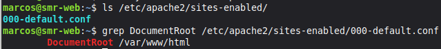

### 2.2. Comprobar que solo hay un sitio activo y qué carpeta usa

```bash
ls /etc/apache2/sites-enabled/
grep DocumentRoot /etc/apache2/sites-enabled/000-default.conf
```

**Salida:**

```text
000-default.conf
        DocumentRoot /var/www/html
```

-  La primera orden muestra **solo** `000-default.conf` → hay **un único sitio activo**.
-  La segunda muestra `DocumentRoot /var/www/html` → la **carpeta** de la web es `/var/www/html`.


### 2.3. Comprobar que mi navegador llega al servidor

En el navegador de mi ordenador abro:

```text
http://192.168.56.16
```

Aparece la página que puse en la primera práctica: **"Servidor de Marcos"**. Ya **no** hace falta usar los nombres `sitio1.local` y `sitio2.local`.


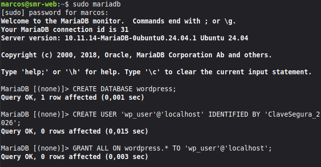

###  Pregunta de reflexión

**¿Qué diferencia hay entre desactivar un sitio con `a2dissite` y borrar sus ficheros? ¿Por qué ahora ves la página por defecto de Apache y antes veías `sitio1`?**

- **`a2dissite`** solo **quita el enlace simbólico** de `sites-enabled`: Apache deja de servir el sitio, pero sus ficheros (`sites-available` y `/var/www/sitio1`) **siguen existiendo** y se puede reactivar con `a2ensite`. **Borrar los ficheros** elimina el sitio de verdad y **no se puede recuperar**.
- **Ahora veo la página por defecto** porque el único sitio activo es `000-default.conf`, cuya carpeta es `/var/www/html`. **Antes veía `sitio1`** porque era el primer virtual host activo y Apache lo usaba para las peticiones que llegaban por la IP.

---

## Apartado 3. Crear la base de datos de WordPress

WordPress necesita un sitio donde guardarlo todo: una **base de datos de MariaDB**. Es como un **armario con una llave**:

-  **El armario** (base de datos) → se llama **`wordpress`**: donde WordPress guarda todos sus datos.
-  **La llave** (usuario) → se llama **`wp_user`**: con lo que WordPress entra en el armario.
-  **El permiso** → **todos, pero solo sobre `wordpress`**: esa llave abre ese armario y ningún otro.

> [!WARNING]
> La contraseña de `wp_user` tiene mínimo **12 caracteres** y usa solo letras, números y guion bajo `_`. **Apúntala en un sitio privado**: la necesitaré en el instalador. En esta memoria aparece como `********`.

### 3.1. Crear la base de datos y el usuario

Entro en MariaDB:

```bash
sudo mariadb
```

Y escribo estas tres órdenes (**cada una termina en `;`**):

```sql
CREATE DATABASE wordpress;
CREATE USER 'wp_user'@'localhost' IDENTIFIED BY '********';
GRANT ALL ON wordpress.* TO 'wp_user'@'localhost';
```

**Salida:** cada una responde `Query OK`:

```text
Query OK, 1 row affected (0,001 sec)
Query OK, 0 rows affected (0,015 sec)
Query OK, 0 rows affected (0,003 sec)
```

Después salgo con `exit`.

**Qué hace cada orden, en una frase:**

- `CREATE DATABASE wordpress;` → **crea el armario**.
- `CREATE USER 'wp_user'@'localhost' IDENTIFIED BY '...';` → **crea la llave** y le pone contraseña. El `@'localhost'` significa que solo puede conectarse **desde el propio servidor**.
- `GRANT ALL ON wordpress.* TO 'wp_user'@'localhost';` → **da permiso** a la llave para usar **solo** el armario `wordpress` (`wordpress.*` = todas las tablas de esa base).

> [!CAUTION]
> En la captura **se ve la contraseña** dentro de la orden `CREATE USER`. **Tápala** (recuadro negro) antes de subir la imagen a GitHub.


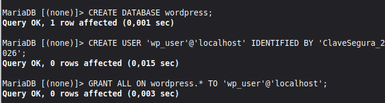

### 3.2. Comprobar que la llave funciona

```bash
mariadb -u wp_user -p wordpress
```

- `-u wp_user` → entra con el usuario `wp_user`.
- `-p` → pide la contraseña (al escribirla no se ve nada).
- `wordpress` → entra directamente en esa base de datos.

**Salida:**

```text
Enter password:
Welcome to the MariaDB monitor.  Commands end with ; or \g.
Your MariaDB connection id is 33
Server version: 10.11.14-MariaDB-0ubuntu0.24.04.1 Ubuntu 24.04
```

 Entro sin errores: **la llave funciona**. Salgo con `exit`.


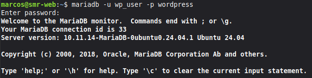

> [!TIP]
> **Si te equivocas y quieres empezar de nuevo:** entra con `sudo mariadb` y ejecuta `DROP DATABASE wordpress;` y `DROP USER 'wp_user'@'localhost';`. Después repite las tres órdenes.

###  Pregunta de reflexión

**¿Por qué WordPress usa su propio usuario `wp_user` con permiso solo sobre su base y no el usuario `root` de MariaDB?**

Por **seguridad** (principio de mínimo privilegio): `root` tiene control total sobre **todas** las bases de datos. Si WordPress tuviera un fallo o se vieran sus credenciales (están en `wp-config.php`), un atacante podría leer, modificar o borrar **todo** el servidor de bases de datos. Con `wp_user`, el daño se limita a la base `wordpress`.

---

## Apartado 4. Descargar e instalar los ficheros de WordPress

### 4.1. Descargar y descomprimir WordPress (en la carpeta temporal)

```bash
sudo apt install wget -y
cd /tmp
wget https://wordpress.org/latest.tar.gz
tar -xzf latest.tar.gz
ls wordpress
```

**Salida relevante:**

```text
wget ya está en su versión más reciente (1.21.4-1ubuntu4.5).
...
Length: 35368461 (34M) [application/octet-stream]
latest.tar.gz       100%[===================>]  33,73M  11,0MB/s    in 3,1s
...
index.php   wp-activate.php   wp-admin   wp-config-sample.php   wp-content   wp-includes   ...
```

**Qué hace cada comando:**

- `sudo apt install wget -y` → instala `wget` (ya estaba instalado).
- `cd /tmp` → me muevo a la **carpeta temporal**.
- `wget https://wordpress.org/latest.tar.gz` → **descarga** la última versión de WordPress (34 MB).
- `tar -xzf latest.tar.gz` → **descomprime** el fichero y crea la carpeta `wordpress`. Las opciones: `x` = extraer, `z` = fichero comprimido con gzip, `f` = el fichero que indico.
- `ls wordpress` → lista el contenido: `index.php`, `wp-admin`, `wp-content`, `wp-config-sample.php`...


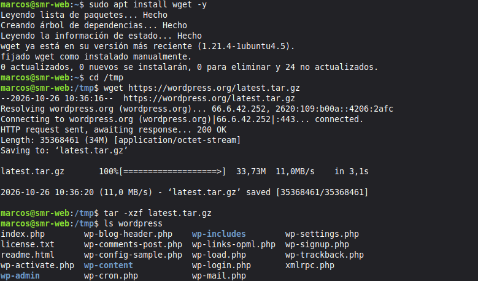

### 4.2. Colocarlo en la carpeta de mi sitio

```bash
sudo rm /var/www/html/index.html
sudo cp -a /tmp/wordpress/. /var/www/html/
rm -r /tmp/wordpress /tmp/latest.tar.gz
ls /var/www/html
```

**Salida de `ls /var/www/html`:**

```text
index.php   license.txt   readme.html   wp-activate.php   wp-admin   wp-blog-header.php   wp-config-sample.php   wp-content   wp-includes   ...
```

###  Explica qué hace cada uno de los comandos que acabas de ejecutar

- **`sudo rm /var/www/html/index.html`** → **borra la página de bienvenida** de Apache. Si no se borra, tendría **prioridad** sobre el `index.php` de WordPress y seguiría saliendo "Servidor de Marcos".
- **`sudo cp -a /tmp/wordpress/. /var/www/html/`** → **copia todo el contenido** de WordPress a la carpeta web. La opción `-a` conserva permisos y atributos, y el `.` final del origen copia también los **ficheros ocultos**. Necesita `sudo` porque `/var/www/html` es de `root`.
- **`rm -r /tmp/wordpress /tmp/latest.tar.gz`** → **borra los temporales** (la carpeta descomprimida y el `.tar.gz`) para no dejar basura. `-r` borra carpetas con su contenido.
- **`ls /var/www/html`** → **comprueba** que los ficheros de WordPress están ya en la carpeta del sitio.

Ahora WordPress está en `/var/www/html` y se verá en `http://192.168.56.16`.

> [!NOTE]
> Si el navegador sigue mostrando la página anterior ("Servidor de Marcos"), puede ser la **caché**. Se puede comprobar desde la terminal con `curl -I http://localhost`.


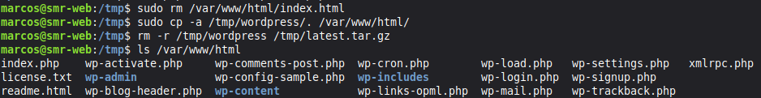

### 4.3. Dar los permisos correctos

Apache se ejecuta con el usuario **`www-data`**, y WordPress necesita poder **escribir** (guardar imágenes, instalar plugins, crear su configuración...):

```bash
sudo chown -R www-data:www-data /var/www/html
sudo find /var/www/html -type d -exec chmod 755 {} \;
sudo find /var/www/html -type f -exec chmod 644 {} \;
ls -ld /var/www/html
```

**Salida de `ls -ld`:**

```text
drwxr-xr-x 5 www-data www-data 4096 oct  6 16:05 /var/www/html
```

 El propietario y el grupo son **`www-data www-data`**.


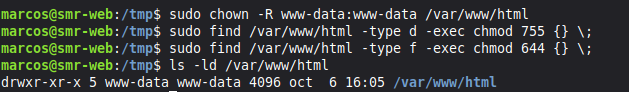

###  Explica qué hace cada una de las órdenes. ¿Por qué hay que cambiar el propietario a `www-data`? ¿Qué podría fallar si siguiera siendo tu usuario?

- **`chown -R www-data:www-data /var/www/html`** → cambia el **propietario y el grupo** de la carpeta y **todo su contenido** (`-R` = recursivo) a `www-data`.
- **`find ... -type d -exec chmod 755 {} \;`** → busca todos los **directorios** y les pone **755** (propietario: leer, escribir y entrar; resto: leer y entrar).
- **`find ... -type f -exec chmod 644 {} \;`** → busca todos los **ficheros** y les pone **644** (propietario: leer y escribir; resto: solo leer).
- **`ls -ld /var/www/html`** → muestra los permisos y el propietario **de la propia carpeta** (`-d` evita listar su contenido).

**¿Por qué `www-data`?** Porque es el usuario con el que **corre Apache** (y por tanto PHP/WordPress). Para escribir en los ficheros, tiene que ser su propietario (o tener permiso de escritura).

**¿Qué fallaría si siguiera siendo mi usuario (`marcos`)?** WordPress **no podría escribir**: no se podrían **subir imágenes**, **instalar o actualizar plugins y temas**, ni **crear `wp-config.php`**. Aparecerían errores de permisos o WordPress pediría credenciales FTP.

> [!IMPORTANT]
> Nunca se usa **777**: cualquier usuario del sistema podría modificar la web. Directorios **755** y ficheros **644**.

---

## Apartado 5. Terminar la instalación desde el navegador (la parte gráfica)

Ahora viene la parte visual. **En el navegador de mi ordenador** abro:

```text
http://192.168.56.16
```

Aparece el **asistente de instalación**. Los pasos:

1.  **Idioma:** elijo **Español** y pulso *Continuar*.
2.  **Bienvenida:** pulso *¡Vamos a ello!*.
3.  **Datos de la base de datos:** relleno los campos y pulso *Enviar*.
4.  **Todo en orden:** pulso *Iniciar la instalación*.
5.  **Información necesaria:** relleno los datos del sitio y pulso *Instalar WordPress*.
6.  **Éxito:** pulso *Iniciar sesión*.

### Pantalla 3: datos de la base de datos

- **Nombre de la base de datos:** `wordpress`
- **Nombre de usuario:** `wp_user`
- **Contraseña:** `********` (la que elegí en el apartado 3)
- **Servidor de la base de datos:** `localhost`
- **Prefijo de tabla:** `wp_` (lo dejo como está)


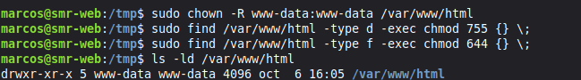

### Pantalla 5: datos de mi sitio

- **Título del sitio:** `Mi primer WordPress`
- **Nombre de usuario:** `Marcos` (**no uso `admin`**: es el primero que prueban los atacantes)
- **Contraseña:** `********` (una **fuerte**; WordPress propone una)
- **Correo electrónico:** el mío
- **Visibilidad en motores de búsqueda:** marcada la casilla *Pedir a los motores de búsqueda que no indexen este sitio* (es un sitio de prácticas)

> [!CAUTION]
> En esta captura **se ve la contraseña en claro y mi correo**. **Pulsa "Ocultar"** antes de hacer la captura, o **tapa** la contraseña (y el correo) con un recuadro negro.


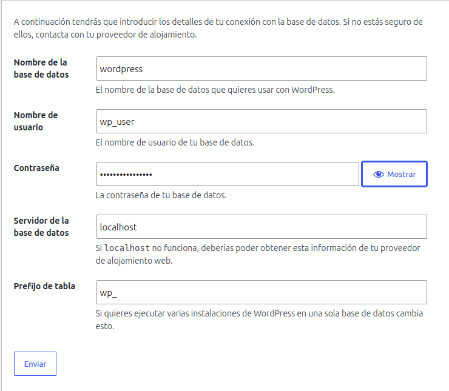

### Qué ha pasado por debajo

- Al enviar la **pantalla 3**, WordPress comprobó que podía entrar en la base de datos y **creó él solo** su fichero de configuración, **`wp-config.php`**.
- En la **pantalla 5**, creó las **tablas** en MariaDB y mi **usuario administrador**.

Inicio sesión con el usuario y la contraseña que acabo de crear y veo el **escritorio de WordPress** (el panel de administración).


> 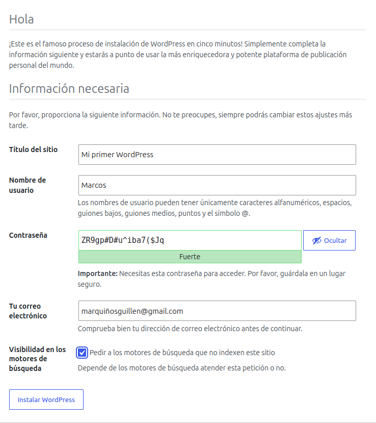

###  Pregunta de reflexión

**¿Qué partes de la instalación has hecho en la terminal y cuáles en el navegador? ¿Por qué el servidor no necesita tener interfaz gráfica?**

-  **En la terminal (SSH):** preparar Apache (un solo sitio), crear la base de datos y el usuario, descargar y descomprimir WordPress, copiarlo a `/var/www/html` y darle permisos.
-  **En el navegador:** el asistente de instalación (datos de la base de datos, título, usuario y contraseña) y el panel de administración.

El servidor **no necesita interfaz gráfica** porque WordPress es una **web**: el servidor solo envía páginas (texto) y es **el navegador de mi ordenador** el que las dibuja.

---

## Apartado 6. Comprobamos que WordPress funciona

### 6.1. La web pública

Abro `http://192.168.56.16` y se ve mi sitio con el título **"Mi primer WordPress"**, con la entrada **"¡Hola, mundo!"** que WordPress crea por defecto.


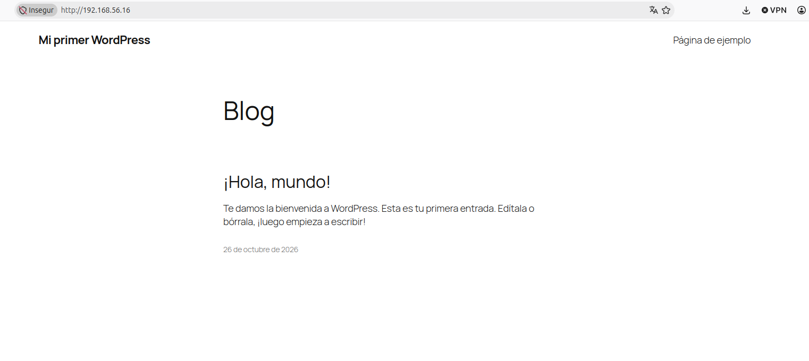

### 6.2. El panel de administración

Abro `http://192.168.56.16/wp-admin` e inicio sesión con mi usuario.

### 6.3. Publicar una entrada de prueba

En el panel: **Entradas → Añadir nueva**. Escribo un título y un texto (mi nombre y la fecha), pulso **Publicar** y compruebo que **aparece en la web pública**.


> ``

### 6.4. ¿Dónde ha guardado WordPress mi entrada? En la base de datos

Lo compruebo en la terminal:

```bash
sudo mariadb wordpress -e "SHOW TABLES;"
```

**Salida:**

```text
+-----------------------+
| Tables_in_wordpress   |
+-----------------------+
| wp_commentmeta        |
| wp_comments           |
| wp_links              |
| wp_options            |
| wp_postmeta           |
| wp_posts              |
| wp_term_relationships |
| wp_term_taxonomy      |
| wp_termmeta           |
| wp_terms              |
| wp_usermeta           |
| wp_users              |
+-----------------------+
```

WordPress creó **12 tablas**, todas empiezan por `wp_`. Las más importantes:

-  **`wp_posts`** → guarda las **entradas y páginas**.
-  **`wp_users`** → guarda los **usuarios**.
-  **`wp_options`** → guarda la **configuración** del sitio.

El comando `mariadb wordpress -e "SHOW TABLES;"` entra en la base `wordpress`, ejecuta **una sola orden** (`-e`) y sale.


### 6.5. Dónde está cada cosa

-  **Los ficheros de WordPress** → `/var/www/html/`
-  **La conexión con la base de datos** → `/var/www/html/wp-config.php` (**no se comparte nunca**: contiene la contraseña)
-  **Temas, plugins e imágenes subidas** → `/var/www/html/wp-content/` (carpetas `themes`, `plugins` y `uploads`)
-  **Las entradas, usuarios y ajustes** → en la **base de datos** `wordpress` de MariaDB

###  Pregunta de reflexión

**¿Dónde guarda WordPress las entradas que escribes: en ficheros del servidor o en la base de datos? ¿Cómo lo has comprobado?**

Las guarda en la **base de datos** (en la tabla `wp_posts`), **no en ficheros**. Lo comprobé con `sudo mariadb wordpress -e "SHOW TABLES;"`, que muestra las tablas que WordPress creó en MariaDB (`wp_posts`, `wp_users`, `wp_options`...). En `/var/www/html` solo están el código de WordPress, los temas, los plugins y los ficheros subidos.

---

## Apartado 7. Para que no se rompa si cambia la IP

WordPress **apunta en su base de datos la dirección con la que lo instalé**. Si la IP de la máquina virtual cambia (por ejemplo, al reiniciarla), WordPress seguiría usando la antigua: la web se vería **sin diseño** y el panel llevaría a una dirección que ya no existe.

La solución: decirle **"usa siempre la dirección con la que te estén visitando"**. Edito la configuración:

```bash
sudo nano /var/www/html/wp-config.php
```

Busco la línea `/* That's all, stop editing! */` (en nano: `Ctrl+W`, escribo `That's all` y Enter). Coloco el cursor al **principio** de esa línea y pego estas dos líneas, dejando una línea en blanco después:

```php
define( 'WP_HOME',    'http://' . $_SERVER['HTTP_HOST'] );
define( 'WP_SITEURL', 'http://' . $_SERVER['HTTP_HOST'] );
```

Guardo con `Ctrl+O`, `Enter`, y salgo con `Ctrl+X`.


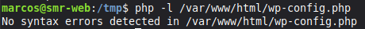

Compruebo que no hay errores de sintaxis:

```bash
php -l /var/www/html/wp-config.php
```

**Salida:**

```text
No syntax errors detected in /var/www/html/wp-config.php
```

 `php -l` (*lint*) revisa la sintaxis del fichero PHP **sin ejecutarlo**. Recargo la web en el navegador y sigue funcionando.


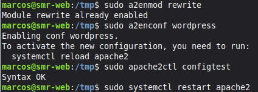

> [!NOTE]
> Estas dos líneas son cómodas para un **laboratorio**. En un servidor real se escribiría la **dirección fija** del sitio.

---

## Apartado 8. Dos ajustes para trabajar cómodamente

Sin estos ajustes aparecen dos problemas muy típicos.

### 8.1. Direcciones "bonitas" (enlaces permanentes)

Por defecto, las entradas tienen direcciones como `http://IP/?p=1`. WordPress puede usar direcciones más claras, como `http://IP/mi-entrada/`, pero para eso crea un fichero **`.htaccess`** que Apache **por defecto ignora**. Si no lo permitimos, al cambiar el formato las entradas dan **error 404**.

**Paso 1: permitir a Apache leer `.htaccess` en la carpeta de WordPress.**

```bash
sudo nano /etc/apache2/conf-available/wordpress.conf
```

Contenido del fichero:

```apache
<Directory /var/www/html>
    AllowOverride All
</Directory>
```

`AllowOverride All` = Apache **sí** lee los ficheros `.htaccess` de esa carpeta.


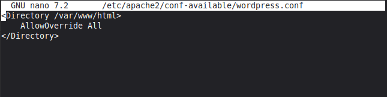

**Paso 2: activarlo.**

```bash
sudo a2enmod rewrite
sudo a2enconf wordpress
sudo apache2ctl configtest
sudo systemctl restart apache2
```

**Salida:**

```text
Module rewrite already enabled
Enabling conf wordpress.
To activate the new configuration, you need to run:
  systemctl reload apache2
Syntax OK
```

- `a2enmod rewrite` → activa el módulo de **reescritura de URL** (ya estaba activo de la práctica de Apache).
- `a2enconf wordpress` → activa el fragmento de configuración que acabo de crear.
- `configtest` → comprueba la sintaxis (`Syntax OK`).
- `restart apache2` → reinicia Apache para aplicar los cambios.


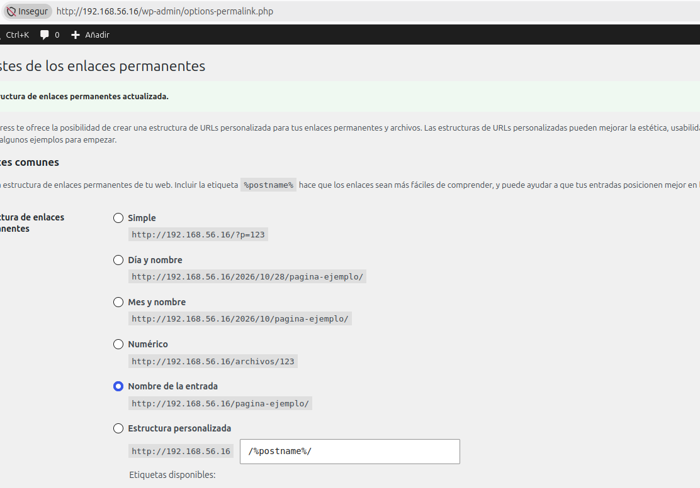

**Paso 3: cambiar el formato en el panel de WordPress.**

**Ajustes → Enlaces permanentes → Nombre de la entrada → Guardar cambios.**

Aparece el mensaje *"Estructura de enlaces permanentes actualizada"*.


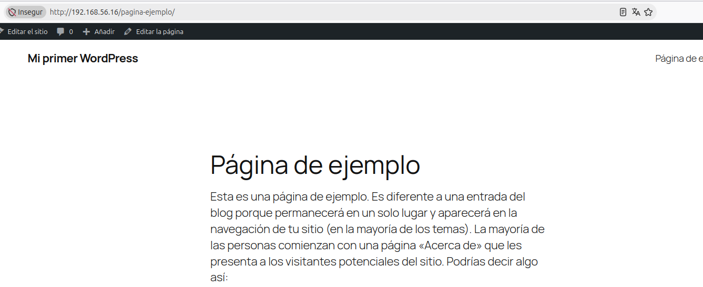

**Paso 4: comprobar que la dirección es "bonita".** Abro una página desde la portada y la dirección ahora es `http://192.168.56.16/pagina-ejemplo/` (en vez de `/?p=2`), y se ve correctamente.


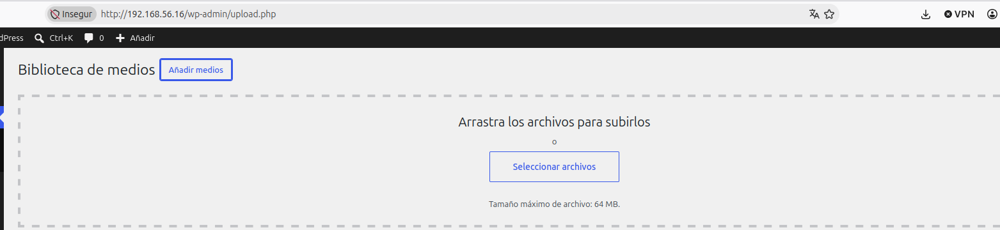

**Paso 5: comprobar que WordPress creó el `.htaccess` solo:**

```bash
ls -la /var/www/html/.htaccess
```


### 8.2. Poder subir ficheros grandes

PHP, por defecto, solo deja subir ficheros de **2 MB**. Muchos temas, plugins y fotos pesan más. Subo el límite a **64 MB**:

```bash
printf 'upload_max_filesize = 64M\npost_max_size = 64M\n' | sudo tee /etc/php/8.3/apache2/conf.d/99-wordpress.ini
sudo systemctl restart apache2
```

- `printf` escribe dos líneas de configuración de PHP (`\n` = salto de línea).
- `sudo tee` las guarda en un fichero nuevo de configuración de PHP para Apache (`99-wordpress.ini`).
- `restart apache2` → Apache vuelve a cargar PHP con el nuevo límite.
- `upload_max_filesize` = tamaño máximo de **cada fichero**; `post_max_size` = tamaño máximo de **toda la petición** (debe ser igual o mayor).

**Compruebo en el panel:** **Medios → Añadir nuevo** → indica *"Tamaño máximo de archivo: 64 MB"*.


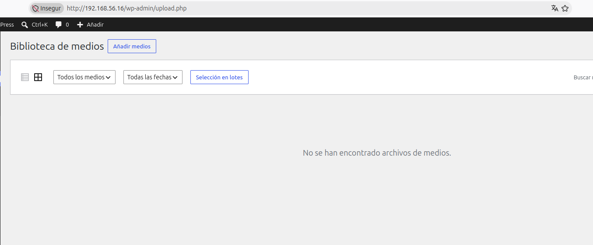

###  Pregunta de reflexión

**¿Por qué las direcciones "bonitas" dan error 404 si Apache no tiene permitido leer el fichero `.htaccess`?**

Porque WordPress escribe en `.htaccess` unas **reglas de reescritura** que mandan **todas las peticiones** a `index.php` (por ejemplo, `/pagina-ejemplo/` → `index.php`, que busca la entrada en la base de datos). Si Apache tiene `AllowOverride None`, **ignora el `.htaccess`**, así que busca un fichero o carpeta real llamado `/pagina-ejemplo/`, que **no existe** → **error 404**. Con `AllowOverride All` sí lee las reglas y todo funciona.

---

## Apartado 9. ¿Qué pasa si MariaDB se para?

WordPress depende de MariaDB: **sin base de datos no puede mostrar nada**. Para verlo, **detengo** MariaDB a propósito:

```bash
sudo systemctl stop mariadb
```

Recargo `http://192.168.56.16` en el navegador y aparece el error:

```text
Error establishing a database connection
```

(en español: *"Error al establecer una conexión con la base de datos"*).

> [!WARNING]
> **"Error establishing a database connection"** = WordPress no puede hablar con MariaDB: o está **parado**, o el **usuario/contraseña** de `wp-config.php` no son correctos.


Ahora **arranco** MariaDB de nuevo y compruebo que funciona:

```bash
sudo systemctl start mariadb
systemctl is-active mariadb
```

**Salida esperada:** `active`.

Recargo la web: **vuelve a funcionar**.


###  Guía rápida cuando WordPress muestre ese error

1. ¿Está MariaDB en marcha? → `systemctl is-active mariadb` (si no, `sudo systemctl start mariadb`).
2. ¿Siguen siendo correctos el usuario y la contraseña? → prueba a entrar con `mariadb -u wp_user -p wordpress`.

###  Pregunta de reflexión

**Cuando WordPress muestra "Error al establecer una conexión con la base de datos", ¿qué dos cosas comprobarías y en qué orden?**

1. **Primero:** si **MariaDB está en marcha** con `systemctl is-active mariadb`. Es lo más habitual y lo más rápido de comprobar. Si está `inactive`, se arranca con `sudo systemctl start mariadb`.
2. **Después:** si el **usuario y la contraseña** siguen siendo correctos, intentando entrar a mano con `mariadb -u wp_user -p wordpress`. Si falla, las credenciales de `wp-config.php` no coinciden con las de MariaDB.

---

## Apartado 10. Comprobación final

```bash
systemctl is-active apache2 mariadb
php -v
ls /etc/apache2/sites-enabled/
sudo mariadb wordpress -e "SHOW TABLES;"
```

**Salida resumida:**

```text
active
active
PHP 8.3.6 (cli) (built: Oct  7 2026 18:06:38) (NTS)
000-default.conf
(las 12 tablas wp_...)
```

-  Apache y MariaDB: `active`.
-  PHP 8.3.6.
-  **Un único sitio** activo: `000-default.conf`.
-  La base `wordpress` tiene sus **12 tablas**.


###  Estado final del servidor

-  **Linux:** Ubuntu 24.04 → instalado.
-  **Apache:** Apache2, con un único sitio → funcionando.
-  **MariaDB:** MariaDB 10.11, con la base `wordpress` → funcionando.
-  **PHP:** PHP 8.3 → funcionando.
-  **WordPress:** instalado en `/var/www/html` → funcionando y accesible desde el navegador.


