# Práctica: Servidor web Apache2 en Ubuntu 24.04

| | |
|---|---|
| **Alumno** | Marcos |
| **Ciclo / Módulo** | Sistemas Microinformáticos y Redes (SMR) · Aplicaciones Web |
| **Curso** | 2026/2027  |
| **Fecha** | Septiembre–octubre de 2026 |
| **Máquina** | `smr-web` · Ubuntu 24.04.5 LTS · IP `192.168.56.16` |

## Índice

1. [Preparación del sistema](#apartado-1-preparación-del-sistema)
2. [Instalación de Apache](#apartado-2-instalación-de-apache)
3. [Comprobación del funcionamiento](#apartado-3-comprobación-del-funcionamiento)
4. [Comandos principales de administración](#apartado-4-comandos-principales-de-administración)
5. [Ficheros y directorios importantes](#apartado-5-ficheros-y-directorios-importantes)
6. [Modificaciones típicas del servicio](#apartado-6-modificaciones-típicas-del-servicio)
7. [Módulos de Apache](#apartado-7-módulos-de-apache)
8. [Virtual Hosts](#apartado-8-varios-sitios-en-un-mismo-servidor-virtual-hosts)
9. [Permisos y propietarios](#apartado-9-permisos-y-propietarios)
10. [Seguridad básica](#apartado-10-seguridad-básica)
11. [Diagnóstico de errores](#apartado-11-diagnóstico-de-errores)
12. [Conclusiones y problemas encontrados](#conclusiones-y-problemas-encontrados)

---

## Apartado 1. Preparación del sistema

Antes de instalar nada actualizo la lista de paquetes (`update`) y los paquetes ya instalados (`upgrade`). Así evito instalar versiones antiguas o con fallos de seguridad ya corregidos.

```bash
sudo apt update
sudo apt upgrade -y
lsb_release -a
```

Salida de `lsb_release -a`:

```text
No LSB modules are available.
Distributor ID: Ubuntu
Description:    Ubuntu 24.04.5 LTS
Release:        24.04
Codename:       noble
```

`lsb_release -a` muestra la distribución y la versión


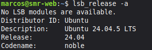

---

## Apartado 2. Instalación de Apache

```bash
sudo apt install apache2 -y
apache2 -v
```

`apt install apache2` descarga e instala el servidor web y las dependencias que necesita. `apache2 -v` muestra la versión instalada; en mi caso **Apache/2.4.58 (Ubuntu)** (se ve también en las cabeceras de las capturas posteriores).


❓ **¿Qué paquetes adicionales se han instalado como dependencias?**

 En una instalación limpia de Ubuntu 24.04 tengo: `apache2-bin`, `apache2-data`, `apache2-utils` , `libapr1t64`, `libaprutil1t64`, `libaprutil1-dbd-sqlite3`, `libaprutil1-ldap` y `liblua5.4-0`. 


## Apartado 3. Comprobación del funcionamiento

### 3.1. Estado del servicio

```bash
sudo systemctl status apache2
```

El servicio aparece como **`active (running)`** y **`enabled`** (arranca solo con el sistema). Se ve el proceso principal (PID 2203) y los procesos hijo que atienden las peticiones.

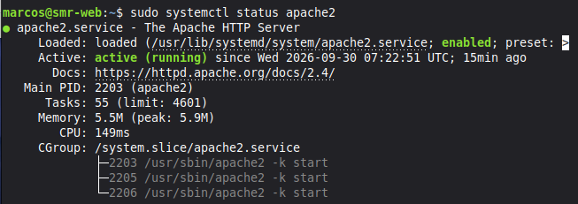

### 3.2. Puertos en escucha

```bash
sudo ss -tulpn | grep apache2
```

`ss` lista los sockets abiertos; filtrando por `apache2` compruebo que escucha en el puerto **80/TCP**.


### 3.3. Prueba desde terminal y navegador

```bash
curl -I http://localhost
```

`curl -I` pide solo las cabeceras HTTP; una respuesta `HTTP/1.1 200 OK` indica que el servidor responde bien. Desde el navegador accedo a `http://192.168.56.16` y aparece la página *Apache2 Default Page – It works!*.


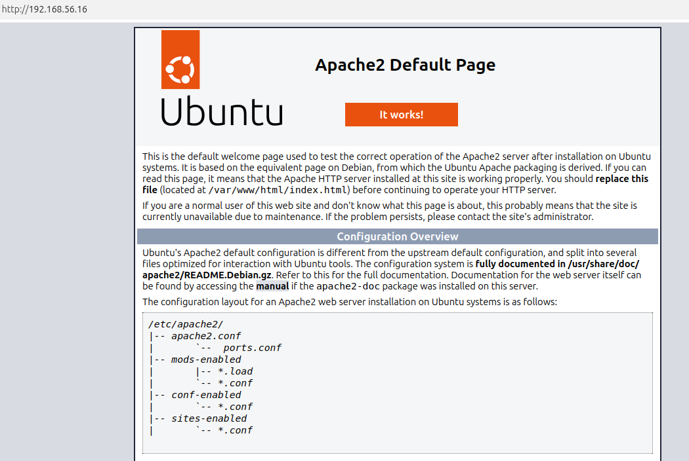

### 3.4. Firewall

```bash
sudo ufw status
sudo ufw allow 'Apache'
```

`ufw status` indica si el cortafuegos está activo y `ufw allow 'Apache'` abre el puerto 80 usando el perfil que instala Apache.


❓ **¿Diferencia entre los perfiles Apache, Apache Full y Apache Secure?**

| Perfil | Puertos que abre | Uso |
|---|---|---|
| `Apache` | 80/tcp | Solo HTTP (sin cifrar) |
| `Apache Secure` | 443/tcp | Solo HTTPS (cifrado con TLS) |
| `Apache Full` | 80/tcp y 443/tcp | HTTP y HTTPS a la vez |

---

## Apartado 4. Comandos principales de administración

| Comando | Función | Explicación  |
|---|---|---|
| `sudo systemctl start apache2` | Inicia el servicio | Lo arranca si está parado |
| `sudo systemctl stop apache2` | Detiene el servicio | La web deja de responder |
| `sudo systemctl restart apache2` | Reinicia (corta conexiones) | Para y arranca de nuevo; necesario p. ej. al activar módulos |
| `sudo systemctl reload apache2` | Recarga la configuración sin cortar conexiones | Aplica cambios sin que los usuarios noten nada |
| `sudo systemctl enable apache2` | Arranque automático | Se inicia solo al encender la máquina |
| `sudo systemctl disable apache2` | Desactiva el arranque automático | Habrá que iniciarlo a mano |
| `apache2ctl configtest` | Comprueba la sintaxis | Detecta errores antes de recargar (`Syntax OK`) |
| `apache2ctl -S` | Muestra los sitios cargados | Útil para ver virtual hosts y a qué fichero pertenecen |
| `apache2ctl -M` | Lista los módulos cargados | Ver qué funcionalidades están activas |
| `a2enmod` / `a2dismod` | Activa / desactiva módulos | Crea o borra el enlace en `mods-enabled` |
| `a2ensite` / `a2dissite` | Activa / desactiva sitios | Igual, en `sites-enabled` |
| `a2enconf` / `a2disconf` | Activa / desactiva fragmentos de configuración | Igual, en `conf-enabled` |


❓ **¿Cuándo conviene `reload` en lugar de `restart`?**

Cuando el servidor está en producción y solo he cambiado la configuración (por ejemplo un virtual host): `reload` relee los ficheros sin matar las conexiones activas, así nadie pierde una descarga o una sesión. `restart` es necesario cuando el cambio lo exige, por ejemplo al **activar o desactivar módulos** o cambiar los puertos de escucha.

---

## Apartado 5. Ficheros y directorios importantes

```bash
ls -l /etc/apache2/
```

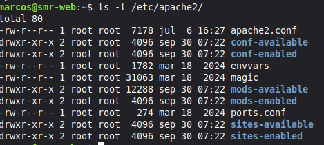

| Ruta | Descripción |
|---|---|
| `/etc/apache2/apache2.conf` | Configuración principal; incluye al resto de ficheros |
| `/etc/apache2/ports.conf` | Puertos en los que escucha Apache (`Listen 80`) |
| `/etc/apache2/sites-available/` | Sitios definidos (activos o no) |
| `/etc/apache2/sites-enabled/` | Sitios activos: enlaces simbólicos a `sites-available` |
| `/etc/apache2/mods-available/` y `mods-enabled/` | Módulos disponibles y módulos activos |
| `/etc/apache2/conf-available/` y `conf-enabled/` | Fragmentos de configuración disponibles y activos |
| `/etc/apache2/envvars` | Variables de entorno (usuario y grupo con el que corre Apache) |
| `/var/www/html/` | `DocumentRoot` por defecto |
| `/var/log/apache2/access.log` | Registro de accesos |
| `/var/log/apache2/error.log` | Registro de errores |

Compruebo que los ficheros de `sites-enabled` son enlaces simbólicos:

```bash
ls -l /etc/apache2/sites-enabled/
```

La salida muestra `000-default.conf -> ../sites-available/000-default.conf` (la `l` inicial y la flecha indican enlace simbólico).


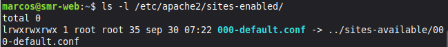

❓ **¿Por qué Apache usa enlaces simbólicos entre `*-available` y `*-enabled`?**

Porque así puedo **activar o desactivar** un sitio, módulo o configuración creando o borrando un enlace, sin tocar ni perder el fichero original. Todo lo que he escrito queda guardado en `*-available`, y en `*-enabled` solo está lo que Apache carga realmente. Es rápido, reversible y evita duplicar ficheros (`a2ensite`/`a2dissite` solo gestionan esos enlaces).

---

## Apartado 6. Modificaciones típicas del servicio

Antes de tocar un fichero hago siempre una copia de seguridad, por si algo sale mal:

```bash
sudo cp /etc/apache2/apache2.conf /etc/apache2/apache2.conf.bak
```

### 6.1. Cambiar la página de inicio

```bash
echo "<h1>Servidor de Marcos</h1>" | sudo tee /var/www/html/index.html
```

`echo` escribe el HTML y `tee` lo guarda en el fichero con permisos de root (una redirección `>` normal no funcionaría con `sudo`). Ahora la página por defecto muestra mi mensaje.


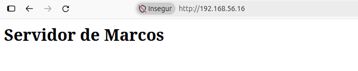

### 6.2. Cambiar el puerto de escucha (8080)

```bash
sudo nano /etc/apache2/ports.conf                     # Listen 80  ->  Listen 8080
sudo nano /etc/apache2/sites-available/000-default.conf   # <VirtualHost *:80> -> *:8080
sudo apache2ctl configtest
sudo systemctl reload apache2
curl -I http://localhost:8080
```

Hay que cambiar el puerto en **dos sitios**: `ports.conf` (en qué puerto escucha Apache) y el `VirtualHost` (qué sitio atiende ese puerto). `configtest` devuelve `Syntax OK` (con el aviso del `ServerName`, que se arregla en el 6.3) y `curl -I` responde `HTTP/1.1 200 OK` en el puerto 8080. Al terminar, **devuelvo el puerto 80**.


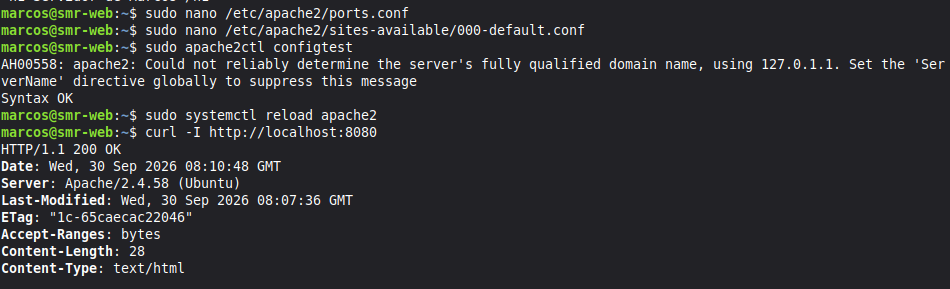


### 6.3. Definir el nombre del servidor

```bash
echo "ServerName localhost" | sudo tee /etc/apache2/conf-available/servername.conf
sudo a2enconf servername
sudo systemctl reload apache2
sudo apache2ctl configtest
```

Así desaparece el aviso *"Could not reliably determine the server's fully qualified domain name"* que se ve en la captura anterior: Apache ya sabe cómo se llama.
`

### 6.4. y 6.5. Cambiar el correo del administrador y personalizar el error 404

En `/etc/apache2/sites-available/000-default.conf` modifico dos directivas:

```apache
ServerAdmin marcos@midominio.local
DocumentRoot /var/www/html
ErrorDocument 404 "Error 404: La pagina que buscas no existe."
```

- `ServerAdmin`: correo que Apache muestra en algunas páginas de error.
- `ErrorDocument 404 "..."`: texto que se muestra cuando se pide una página que no existe.


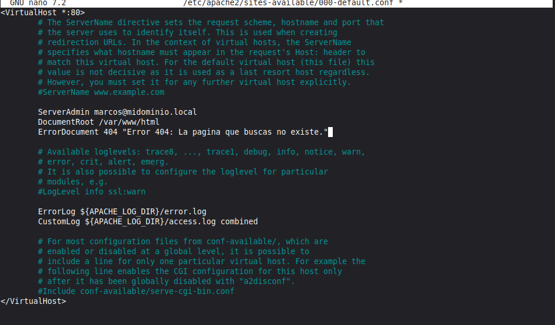

---

## Apartado 7. Módulos de Apache

Apache es modular: solo carga las funciones que necesita.

```bash
apache2ctl -M
ls /etc/apache2/mods-available/
```

`-M` muestra los módulos cargados (*static* los compilados dentro de Apache, *shared* los cargados dinámicamente) y `mods-available` todos los que se pueden activar.


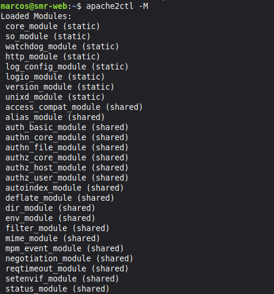


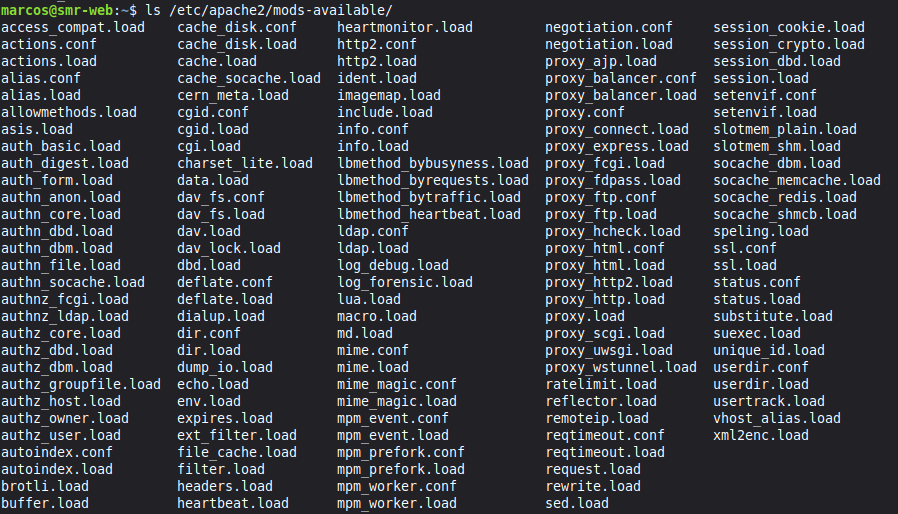

Activo tres módulos y compruebo que están cargados:

```bash
sudo a2enmod rewrite
sudo a2enmod headers
sudo a2enmod ssl
sudo systemctl restart apache2
apache2ctl -M | grep -E "rewrite|headers|ssl"
```

Al activar `ssl`, `a2enmod` activa automáticamente su dependencia `socache_shmcb` (`mime` ya estaba activo). Hace falta **reiniciar** para que se carguen, y el `grep` confirma `headers_module`, `rewrite_module` y `ssl_module`.


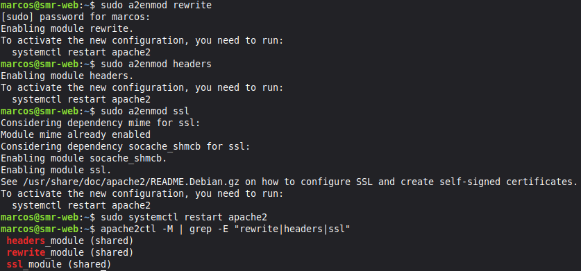

| Módulo | Función |
|---|---|
| `mod_rewrite` | Reescritura de URL (URLs amigables, redirecciones) |
| `mod_headers` | Modificar cabeceras HTTP (seguridad, caché) |
| `mod_ssl` | Soporte HTTPS / TLS |
| `mod_dir` | Fichero índice por defecto (`index.html`) |
| `mod_alias` | Alias de rutas y redirecciones simples |
| `mod_auth_basic` | Autenticación básica con usuario y contraseña |
| `mod_status` | Página de estado del servidor (`/server-status`) |
| `mod_deflate` | Compresión de las respuestas |
| `mod_php` / PHP-FPM | Ejecución de PHP (opcional) |

Desactivar un módulo y ver el efecto:

```bash
sudo a2dismod status
sudo systemctl restart apache2
apache2ctl -M | grep status
```

> 📸 **(FALTA – haz esta captura)** `a2dismod status` + `apache2ctl -M | grep status` sin resultados.

❓ **¿Qué ocurre si desactivas un módulo del que depende otro?**

Apache avisa o falla: `a2dismod` suele advertir de que otros módulos dependen de él, y si queda alguna directiva del módulo apagado en la configuración, `configtest` da error (*Invalid command...*) y Apache puede no arrancar. Por eso hay que probar siempre con `apache2ctl configtest` antes de reiniciar.

---

## Apartado 8. Varios sitios en un mismo servidor (Virtual Hosts)

Creo dos sitios: `sitio1.local` y `sitio2.local`.

### 8.1. Directorios y páginas

```bash
sudo mkdir -p /var/www/sitio1 /var/www/sitio2
echo "<h1>Bienvenido a SITIO 1</h1>" | sudo tee /var/www/sitio1/index.html
echo "<h1>Bienvenido a SITIO 2</h1>" | sudo tee /var/www/sitio2/index.html
```

Cada sitio tiene su propia carpeta y su propia página. En la captura se ve un fallo mío: al pegar el segundo `echo` se coló un carácter de control (`^[[200~`) y salió `command not found`; lo repetí y funcionó (ver *Problemas encontrados*).

> 📸 **PON AQUÍ LA IMAGEN `e 11.png`** → `img/12-crear-sitios.png`


### 8.2. Ficheros de configuración

```bash
sudo nano /etc/apache2/sites-available/sitio1.conf
sudo nano /etc/apache2/sites-available/sitio2.conf
```

> 📸 **PON AQUÍ LA IMAGEN `e 12.png`** → `img/13-nano-sitio2.png`


Contenido de `sitio2.conf` (el de `sitio1.conf` es igual cambiando nombres y rutas):

```apache
<VirtualHost *:80>
    ServerName sitio2.local
    ServerAdmin admin@sitio2.local
    DocumentRoot /var/www/sitio2

    <Directory /var/www/sitio2>
        Options -Indexes +FollowSymLinks
        AllowOverride None
        Require all granted
    </Directory>

    ErrorLog ${APACHE_LOG_DIR}/sitio2_error.log
    CustomLog ${APACHE_LOG_DIR}/sitio2_access.log combined
</VirtualHost>
```

- `ServerName`: nombre con el que Apache reconoce este sitio.
- `DocumentRoot`: carpeta con los ficheros de la web.
- `Options -Indexes`: evita que se liste el contenido de la carpeta si no hay `index.html`.
- `AllowOverride None`: ignora los `.htaccess` (más seguro y rápido).
- `Require all granted`: permite el acceso a todos.
- `ErrorLog` / `CustomLog`: logs propios de cada sitio.

> 📸 **PON AQUÍ LA IMAGEN `e 13.png`** → `img/14-sitio2-conf.png`


> 📸 **(FALTA – recomendable)** Captura del contenido de `sitio1.conf`.

### 8.3. Activar los sitios y desactivar el de por defecto

```bash
sudo a2ensite sitio1.conf sitio2.conf
sudo a2dissite 000-default.conf
sudo apache2ctl configtest
sudo systemctl reload apache2
apache2ctl -S
```

> 📸 **(FALTA – OBLIGATORIA según el enunciado)** Captura de la salida de `apache2ctl -S`, donde se ven los dos virtual hosts por nombre. Guárdala como `img/15b-apache2ctl-S.png`:
> ``

### 8.4. Resolución de nombres

```bash
sudo nano /etc/hosts
```

```text
127.0.0.1 sitio1.local sitio2.local
```

El fichero `/etc/hosts` actúa como un DNS local: así `sitio1.local` y `sitio2.local` se resuelven a mi máquina sin tener un servidor DNS. En el equipo cliente habría que poner la IP real (`192.168.56.16`).

### 8.5. Pruebas

```bash
curl http://sitio1.local
curl http://sitio2.local
```

Cada nombre devuelve su propia página, aunque ambos van al mismo servidor y puerto: Apache decide según la cabecera `Host`.

> 📸 **PON AQUÍ LA IMAGEN `e 16.png`** → `img/16-curl-sitios.png`


Desde el navegador, entrando por la IP (sin nombre) se sirve el **primer** virtual host cargado (`sitio1`, por orden alfabético), que actúa como sitio por defecto:

> 📸 **PON AQUÍ LA IMAGEN `e 15.png`** → `img/15-sitio1-navegador.png`


> 📸 **(FALTA)** Captura del navegador con `http://sitio2.local` (si lo pruebas desde un equipo con el `hosts` modificado).

❓ **¿Diferencia entre virtual hosts basados en nombre y en IP? ¿Cuál he usado?**

- **Basados en nombre:** varios sitios comparten IP y puerto; Apache elige según el nombre de la cabecera `Host` (`ServerName`). Es el más habitual y no gasta IPs.
- **Basados en IP:** cada sitio tiene su propia IP y Apache elige por la IP a la que llega la petición.

Yo he usado **virtual hosts basados en nombre** (`ServerName sitio1.local` / `sitio2.local` en `*:80`).

---

## Apartado 9. Permisos y propietarios

Apache se ejecuta con el usuario `www-data`, no como root:

```bash
ps aux | grep apache2
grep -E "APACHE_RUN_(USER|GROUP)" /etc/apache2/envvars
ls -ld /var/www/sitio1 /var/www/sitio1/index.html
```

El proceso padre corre como `root` (necesita abrir el puerto 80) y los procesos que atienden peticiones, como `www-data`. En `envvars` se ve `APACHE_RUN_USER=www-data` y `APACHE_RUN_GROUP=www-data`. Los ficheros que había creado con `sudo` pertenecen a `root:root` (`drwxr-xr-x` y `-rw-r--r--`).

> 📸 **PON AQUÍ LA IMAGEN `e 17.png`** → `img/17-usuario-www-data.png`


Aplico una política de permisos razonable:

```bash
sudo chown -R www-data:www-data /var/www/sitio1
sudo find /var/www/sitio1 -type d -exec chmod 755 {} \;
sudo find /var/www/sitio1 -type f -exec chmod 644 {} \;
```

> 📸 **PON AQUÍ LA IMAGEN `e 18.png`** → `img/18-chown-chmod.png`


Ahora provoco un error 403 quitando todos los permisos al `index.html`:

```bash
sudo chmod 000 /var/www/sitio1/index.html
```

> 📸 **PON AQUÍ LA IMAGEN `e 19.png`** → `img/19-chmod-000.png`


El navegador muestra **Forbidden – You don't have permission to access this resource**:

> 📸 **PON AQUÍ LA IMAGEN `e 20.png`** → `img/20-error-403.png`


Consulto el log para ver la causa:

```bash
sudo tail -n 5 /var/log/apache2/sitio1_error.log
```

> 📸 **(FALTA – lo pide el enunciado)** Captura del log con la línea `AH01630: client denied by server configuration` / `Permission denied`. Guárdala como `img/20b-error-log-403.png`:
> ``

Después restauro los permisos:

```bash
sudo chmod 644 /var/www/sitio1/index.html
```

### Explicaciones

**¿Qué significan 755 y 644?** Cada cifra es la suma de r=4, w=2, x=1, para propietario / grupo / otros:

| Permiso | Propietario | Grupo | Otros | Uso |
|---|---|---|---|---|
| `755` | rwx | r-x | r-x | Directorios (necesitan `x` para entrar) |
| `644` | rw- | r-- | r-- | Ficheros (se pueden leer pero no ejecutar) |

**¿Por qué nunca 777?** Porque cualquier usuario o proceso del sistema podría modificar o sustituir ficheros de la web. Si una aplicación web tiene un fallo, un atacante podría subir y ejecutar código en el servidor.

**¿Por qué el contenido web no debe ser de root ni escribible por todos?** Si es de root, Apache (`www-data`) solo lo lee, lo que está bien, pero ejecutar/administrar la web como root da demasiado poder si algo se compromete. Si es escribible por todos, cualquiera puede alterarlo. Lo correcto: propietario `www-data` (o un usuario de despliegue), permisos mínimos y escritura solo donde sea imprescindible.

---

## Apartado 10. Seguridad básica

> ⚠️ **Este apartado no tiene capturas en lo que me has pasado, y el enunciado no detalla qué hacer.** Te dejo una propuesta estándar para que lo hagas y captures. Haz cada comando y guarda una captura en `img/` (p. ej. `img/21-...png`).

### 10.1. Ocultar la versión de Apache

```bash
sudo nano /etc/apache2/conf-available/security.conf
```

```apache
ServerTokens Prod
ServerSignature Off
```

```bash
sudo systemctl reload apache2
curl -I http://localhost
```

Con `ServerTokens Prod` la cabecera `Server` solo dice `Apache` (sin versión ni sistema) y `ServerSignature Off` quita el pie de página con datos en las páginas de error. Así un atacante lo tiene más difícil para buscar vulnerabilidades de una versión concreta.

> 📸 **(FALTA)** `curl -I` mostrando `Server: Apache`.

### 10.2. Desactivar el listado de directorios

Ya lo hice con `Options -Indexes` en los virtual hosts (apartado 8). Compruébalo creando una carpeta vacía dentro de `/var/www/sitio1/` y entrando por el navegador: debe dar 403 en vez de listar el contenido.

> 📸 **(FALTA)** Captura de esa prueba.

### 10.3. Firewall

```bash
sudo ufw allow 'Apache'
sudo ufw status verbose
```

Solo se abre el puerto necesario (80, o `Apache Full` si hay HTTPS).

> 📸 **(FALTA)** Captura de `ufw status`.

### 10.4. Resumen de medidas

| Medida | Qué evita |
|---|---|
| `ServerTokens Prod` / `ServerSignature Off` | Filtrar versión y SO |
| `Options -Indexes` | Listados de directorios |
| `AllowOverride None` | `.htaccess` no autorizados |
| Permisos 755/644 y propietario `www-data` | Modificaciones no autorizadas |
| Firewall `ufw` | Puertos innecesarios abiertos |
| Desactivar módulos que no se usan (`a2dismod status`) | Reducir superficie de ataque |

---

## Apartado 11. Diagnóstico de errores

> ⚠️ **Tampoco hay capturas ni enunciado detallado de este apartado.** Te dejo la tabla de fallos habituales; si tu profesor te pidió provocar errores concretos, añade tus capturas.

| Síntoma | Causa probable | Cómo diagnosticarlo | Solución |
|---|---|---|---|
| El servicio no arranca | Error de sintaxis en la configuración | `apache2ctl configtest`, `journalctl -xeu apache2` | Corregir el fichero indicado y recargar |
| `Address already in use` | Otro servicio usa el puerto 80/8080 | `sudo ss -tulpn \| grep :80` | Parar el otro servicio o cambiar el puerto |
| **403 Forbidden** | Permisos incorrectos o `Require` mal puesto | `tail /var/log/apache2/error.log`, `ls -l` | `chmod 644` / `755`, `chown www-data` |
| **404 Not Found** | La ruta no existe / `DocumentRoot` mal | Revisar `DocumentRoot` y el log de accesos | Corregir ruta o crear el fichero |
| Aviso `AH00558` (FQDN) | Falta `ServerName` global | `apache2ctl configtest` | `ServerName localhost` en `conf-available` |
| Se ve el sitio equivocado | Virtual host no activo o `Host` mal | `apache2ctl -S`, `/etc/hosts` | `a2ensite` y revisar `ServerName` |
| No accedo desde otro equipo | Firewall o IP incorrecta | `ufw status`, `ip a` | `ufw allow 'Apache'` |

Comandos útiles de diagnóstico:

```bash
sudo systemctl status apache2
sudo journalctl -xeu apache2
sudo tail -f /var/log/apache2/error.log
apache2ctl configtest
apache2ctl -S
```

El caso del **403** ya lo provoqué y diagnostiqué de verdad en el apartado 9.

---

## Conclusiones y problemas encontrados

### Conclusiones

Con esta práctica he aprendido a instalar y comprobar Apache2 en Ubuntu 24.04, a manejar el servicio con `systemctl` y a entender cómo se organiza su configuración (`available` / `enabled` con enlaces simbólicos). He alojado dos webs en un mismo servidor con virtual hosts por nombre, he activado módulos y he visto la importancia de los permisos y del usuario `www-data`.
> ✏️ *Añade aquí 2–3 frases con tu opinión personal.*

### Problemas encontrados y cómo los resolví

| Problema | Cómo lo resolví |
|---|---|
| Aviso `AH00558: Could not reliably determine the server's fully qualified domain name` | Definí `ServerName localhost` en `conf-available/servername.conf` y lo activé con `a2enconf` |
| Al pegar el `echo` del sitio 2 apareció `^[[200~echo: command not found` (carácter de pegado) | Escribí el comando de nuevo a mano y funcionó |
| Al activar módulos no cambiaba nada | Hacía falta `systemctl restart apache2` |
| Tras `chmod 000` el navegador mostraba 403 | Lo consulté en `error.log` y restauré con `chmod 644` |
| ✏️ *Añade aquí cualquier otro problema real que hayas tenido* | |

---

*Memoria enlazada desde el [README.md](README.md) del repositorio.*
